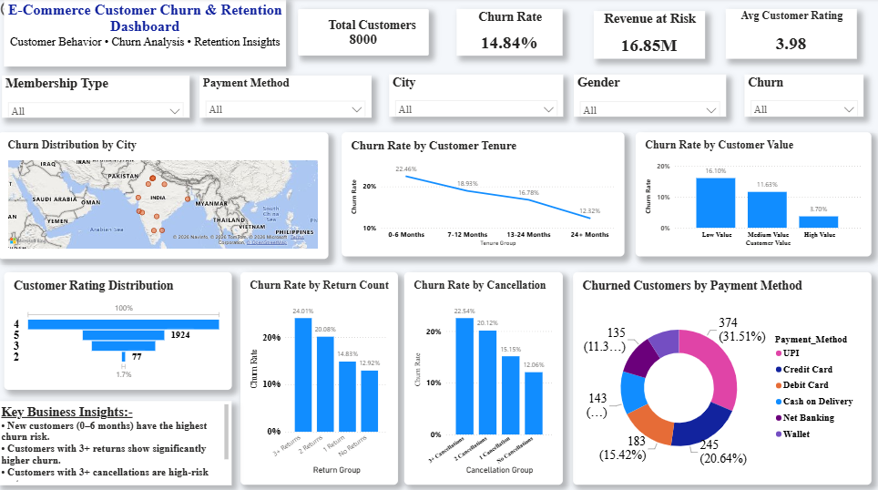

# 📊 E-Commerce Customer Churn Analysis & Retention Dashboard

An end-to-end **Customer Churn Analysis project** built using **Excel, MySQL, SQL and Power BI** to identify high-risk customer segments and generate actionable retention insights.

---

## 🎯 Project Overview
## 📊 Dashboard Preview



The objective of this project is to analyze customer behavior and understand the key factors associated with customer churn in an e-commerce business.

The project covers the complete analytics workflow:

**Data Cleaning → SQL Analysis → KPI Development → Power BI Dashboard → Business Insights**

---

## 🎯 Business Problem

The business wants to understand:

- What is the overall customer churn rate?
- Which customer segments have the highest churn risk?
- How does customer tenure affect churn?
- Does order frequency influence churn?
- How do customer ratings relate to churn?
- Do returns and cancellations increase churn?
- Which customer-value segments are most at risk?
- Which payment methods have the highest number of churned customers?

---

## 🗂️ Dataset

The dataset contains **8,000 customer records** and **17 attributes**.

### Main Fields

| Field | Description |
|---|---|
| Customer_ID | Unique customer identifier |
| Age | Customer age |
| Gender | Customer gender |
| City | Customer city |
| Membership_Type | Customer membership category |
| Tenure_Months | Customer relationship duration |
| Total_Orders | Total number of orders |
| Total_Spend | Total customer spending |
| Avg_Order_Value | Average order value |
| Last_Order_Days_Ago | Days since last order |
| Discount_Used | Discount usage |
| Return_Count | Number of returns |
| Customer_Rating | Customer rating |
| Payment_Method | Payment method |
| Support_Tickets | Number of support tickets |
| Cancellation_Count | Number of cancellations |
| Churn | Customer churn status |

---

## 🛠️ Tools & Technologies

- **Excel** — Data cleaning and validation
- **MySQL** — Data analysis and SQL queries
- **SQL** — Aggregation, segmentation and churn analysis
- **Power BI** — Interactive dashboard and visualization
- **DAX** — KPI calculations and dynamic measures
- **GitHub** — Project documentation and version control

---

## 📌 Key KPIs

The Power BI dashboard tracks:

- 👥 Total Customers
- 📉 Churn Rate
- 💰 Revenue at Risk
- ⭐ Average Customer Rating
- 🔄 Retention Rate
- 🛒 Total Orders
- 💵 Total Spend

---

## 📊 Power BI Dashboard

The dashboard includes interactive filters for:

- Membership Type
- Payment Method
- City
- Gender
- Churn Status
- Return Group
- Cancellation Count
- Risk Segment

### Dashboard Visuals

- Customer Churn Distribution by City
- Churn Rate by Customer Tenure
- Churn Rate by Customer Value
- Customer Rating Distribution
- Churn Rate by Return Count
- Churn Rate by Cancellation Count
- Churned Customers by Payment Method
- Key Business Insights

---

## 🔎 SQL Analysis

SQL was used to analyze churn across multiple customer segments.

### Overall Churn

- Total Customers: **8,000**
- Churned Customers: **1,187**
- Non-Churned Customers: **6,813**
- Overall Churn Rate: **14.84%**

### Churn by Tenure

| Tenure Group | Churn Rate |
|---|---:|
| 0–6 Months | 22.46% |
| 7–12 Months | 18.93% |
| 13–24 Months | 16.78% |
| 24+ Months | 12.32% |

### Churn by Order Frequency

| Order Group | Churn Rate |
|---|---:|
| 1–5 Orders | 22.12% |
| 6–10 Orders | 17.73% |
| 11–20 Orders | 12.54% |
| 20+ Orders | 11.24% |

### Churn by Customer Rating

| Rating Group | Churn Rate |
|---|---:|
| Below 3 | 19.11% |
| 3.0–3.9 | 15.50% |
| 4.0–4.4 | 14.50% |
| 4.5–5.0 | 13.15% |

### Churn by Returns

| Return Group | Churn Rate |
|---|---:|
| 3+ Returns | 24.01% |
| 2 Returns | 20.08% |
| 1 Return | 14.83% |
| No Returns | 12.92% |

### Churn by Cancellations

| Cancellation Group | Churn Rate |
|---|---:|
| 3+ Cancellations | 22.54% |
| 2 Cancellations | 20.12% |
| 1 Cancellation | 15.15% |
| No Cancellations | 12.06% |

---

## 💡 Key Business Insights

### 1. New Customers Are at Higher Risk

Customers with **0–6 months of tenure** have a churn rate of **22.46%**, significantly higher than customers with 24+ months of tenure.

### 2. Low Order Frequency Indicates Higher Churn

Customers with only **1–5 orders** have a churn rate of **22.12%**.

### 3. Returns Are a Strong Churn Indicator

Customers with **3+ returns** have the highest return-related churn rate at **24.01%**.

### 4. Cancellations Increase Churn Risk

Customers with **3+ cancellations** have a churn rate of **22.54%**.

### 5. Customer Experience Matters

Customers with ratings below 3 have a churn rate of **19.11%**, indicating a relationship between poor customer experience and churn.

### 6. High-Value Customers Have Lower Churn

High-value customers show significantly lower churn compared with low-value customers.

---

## 💼 Business Recommendations

Based on the analysis, the following retention strategies are recommended:

# 📊 E-Commerce Customer Churn Analysis & Retention Dashboard

An end-to-end **Customer Churn Analysis project** built using **Excel, MySQL, SQL and Power BI** to identify high-risk customer segments and generate actionable retention insights.

---

## 🎯 Project Overview

The objective of this project is to analyze customer behavior and understand the key factors associated with customer churn in an e-commerce business.

The project covers the complete analytics workflow:

**Data Cleaning → SQL Analysis → KPI Development → Power BI Dashboard → Business Insights**

---

## 🎯 Business Problem

The business wants to understand:

- What is the overall customer churn rate?
- Which customer segments have the highest churn risk?
- How does customer tenure affect churn?
- Does order frequency influence churn?
- How do customer ratings relate to churn?
- Do returns and cancellations increase churn?
- Which customer-value segments are most at risk?
- Which payment methods have the highest number of churned customers?

---

## 🗂️ Dataset

The dataset contains **8,000 customer records** and **17 attributes**.

### Main Fields

| Field | Description |
|---|---|
| Customer_ID | Unique customer identifier |
| Age | Customer age |
| Gender | Customer gender |
| City | Customer city |
| Membership_Type | Customer membership category |
| Tenure_Months | Customer relationship duration |
| Total_Orders | Total number of orders |
| Total_Spend | Total customer spending |
| Avg_Order_Value | Average order value |
| Last_Order_Days_Ago | Days since last order |
| Discount_Used | Discount usage |
| Return_Count | Number of returns |
| Customer_Rating | Customer rating |
| Payment_Method | Payment method |
| Support_Tickets | Number of support tickets |
| Cancellation_Count | Number of cancellations |
| Churn | Customer churn status |

---

## 🛠️ Tools & Technologies

- **Excel** — Data cleaning and validation
- **MySQL** — Data analysis and SQL queries
- **SQL** — Aggregation, segmentation and churn analysis
- **Power BI** — Interactive dashboard and visualization
- **DAX** — KPI calculations and dynamic measures
- **GitHub** — Project documentation and version control

---

## 📌 Key KPIs

The Power BI dashboard tracks:

- 👥 Total Customers
- 📉 Churn Rate
- 💰 Revenue at Risk
- ⭐ Average Customer Rating
- 🔄 Retention Rate
- 🛒 Total Orders
- 💵 Total Spend

---

## 📊 Power BI Dashboard

The dashboard includes interactive filters for:

- Membership Type
- Payment Method
- City
- Gender
- Churn Status
- Return Group
- Cancellation Count
- Risk Segment

### Dashboard Visuals

- Customer Churn Distribution by City
- Churn Rate by Customer Tenure
- Churn Rate by Customer Value
- Customer Rating Distribution
- Churn Rate by Return Count
- Churn Rate by Cancellation Count
- Churned Customers by Payment Method
- Key Business Insights

---

## 🔎 SQL Analysis

SQL was used to analyze churn across multiple customer segments.

### Overall Churn

- Total Customers: **8,000**
- Churned Customers: **1,187**
- Non-Churned Customers: **6,813**
- Overall Churn Rate: **14.84%**

### Churn by Tenure

| Tenure Group | Churn Rate |
|---|---:|
| 0–6 Months | 22.46% |
| 7–12 Months | 18.93% |
| 13–24 Months | 16.78% |
| 24+ Months | 12.32% |

### Churn by Order Frequency

| Order Group | Churn Rate |
|---|---:|
| 1–5 Orders | 22.12% |
| 6–10 Orders | 17.73% |
| 11–20 Orders | 12.54% |
| 20+ Orders | 11.24% |

### Churn by Customer Rating

| Rating Group | Churn Rate |
|---|---:|
| Below 3 | 19.11% |
| 3.0–3.9 | 15.50% |
| 4.0–4.4 | 14.50% |
| 4.5–5.0 | 13.15% |

### Churn by Returns

| Return Group | Churn Rate |
|---|---:|
| 3+ Returns | 24.01% |
| 2 Returns | 20.08% |
| 1 Return | 14.83% |
| No Returns | 12.92% |

### Churn by Cancellations

| Cancellation Group | Churn Rate |
|---|---:|
| 3+ Cancellations | 22.54% |
| 2 Cancellations | 20.12% |
| 1 Cancellation | 15.15% |
| No Cancellations | 12.06% |

---

## 💡 Key Business Insights

### 1. New Customers Are at Higher Risk

Customers with **0–6 months of tenure** have a churn rate of **22.46%**, significantly higher than customers with 24+ months of tenure.

### 2. Low Order Frequency Indicates Higher Churn

Customers with only **1–5 orders** have a churn rate of **22.12%**.

### 3. Returns Are a Strong Churn Indicator

Customers with **3+ returns** have the highest return-related churn rate at **24.01%**.

### 4. Cancellations Increase Churn Risk

Customers with **3+ cancellations** have a churn rate of **22.54%**.

### 5. Customer Experience Matters

Customers with ratings below 3 have a churn rate of **19.11%**, indicating a relationship between poor customer experience and churn.

### 6. High-Value Customers Have Lower Churn

High-value customers show significantly lower churn compared with low-value customers.

---

## 💼 Business Recommendations

Based on the analysis, the following retention strategies are recommended:

1. **Focus on new customers during their first 6–12 months.**
2. Create targeted onboarding and engagement campaigns.
3. Encourage repeat purchases among low-order-frequency customers.
4. Investigate customers with multiple returns.
5. Monitor customers with frequent order cancellations.
6. Improve customer service for customers with low ratings.
7. Create personalized retention offers for high-risk customers.
8. Monitor customer behavior continuously using the Power BI dashboard.

---

## 📁 Project Files

- `Ecommerce_Customer_Churn_Analysis.csv` — Customer dataset
- `churn_analysis.sql` — SQL analysis queries
- `churn.pbix` — Power BI dashboard
- `ecommerce-churn-dashboard.png` — Dashboard preview
- `README.md` — Project documentation

---

## 🔄 Project Workflow

```text
Raw Customer Data
       ↓
Excel Data Cleaning
       ↓
MySQL Data Analysis
       ↓
SQL Churn Analysis
       ↓
DAX KPI Calculations
       ↓
Power BI Dashboard
       ↓
Business Insights
       ↓
Customer Retention Strategy
```

---

## 👨‍💻 Author

**Abhishek Sharma**

Aspiring Data Analyst

### Skills

**Excel | SQL | MySQL | Power BI | DAX | Data Visualization | Google Sheets**

---

## ⭐ Project Objective

This project demonstrates practical skills in:

- Data Cleaning
- SQL Analysis
- Customer Segmentation
- KPI Development
- Data Visualization
- Power BI Dashboard Development
- Business Intelligence
- Data-Driven Decision Making
